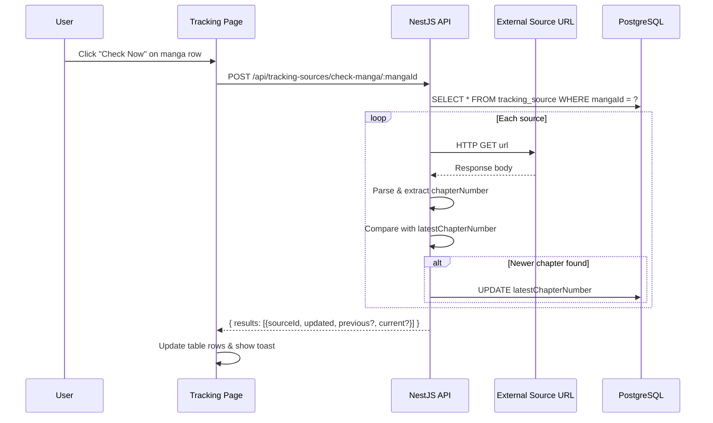
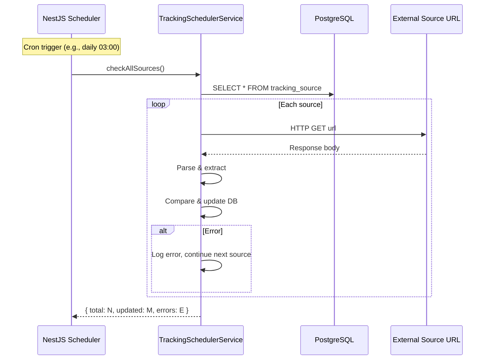

# Business Requirements Document — External Manga Tracking Feature

| **Document** | BRD-001 |
|---|---|
| **Feature** | External Manga Chapter Tracking |
| **Author** | Anna (BA) |
| **Version** | 1.0 |
| **Date** | 2026-07-23 |
| **Status** | Draft — pending stakeholder review |

---

## 1. Business Context & Objectives

### 1.1 Problem Statement

Manga readers currently manage their library offline. When new chapters are released on external scanlation sites or official platforms, users must manually check each site to discover updates. There is no automated way to consolidate chapter release information from multiple external sources into a single view.

### 1.2 Business Objectives

| Objective | Metric |
|-----------|--------|
| Reduce manual effort in checking for new chapters | Time saved per manga per week |
| Centralize external chapter discovery | Sources tracked per manga |
| Provide timely chapter release awareness | Detection latency (hours) |
| Minimize API dependency failures | Success rate of external checks |

### 1.3 Success Criteria

- Users can register 1+ external source URLs per manga
- The system can call those URLs, parse the response, and detect newer chapters
- A daily cronjob discovers updates without user intervention
- The tracking page shows actionable differences (current vs. latest found)

---

## 2. Stakeholders

| Stakeholder | Interest | Involvement |
|-------------|----------|-------------|
| End User (Reader) | Discover new chapters automatically | Creates/manages tracking sources, views results |
| Developer | Implement backend + frontend | Builds entities, APIs, cronjob, UI |
| DevOps | Ensure cronjob reliability | Infrastructure for scheduled tasks |

---

## 3. Data Model

### 3.1 TrackingSource Entity

Stored in PostgreSQL via TypeORM — aligned with existing entity conventions.

| Field | Type | Constraints | Description |
|-------|------|-------------|-------------|
| `id` | `number` (PK, auto-increment) | `@PrimaryGeneratedColumn()` | Internal ID |
| `mangaId` | `number` | FK → Manga, `@ManyToOne`, CASCADE delete | The manga being tracked |
| `url` | `string` | `@Column()`, not nullable, validated URL | The external API endpoint to check |
| `name` | `string` | `@Column()`, not nullable | Human-readable label (e.g., "MangaDex EN") |
| `latestChapterNumber` | `string` | `@Column()`, nullable, default `null` | Last known chapter number from this source |
| `createdAt` | `Date` | `@CreateDateColumn()` | Auto timestamp |
| `updatedAt` | `Date` | `@UpdateDateColumn()` | Auto timestamp |

**Relations:**
- `@ManyToOne(() => Manga, (manga) => manga.trackingSources)` with `onDelete: 'CASCADE'`

**Uniqueness:**
- `@Unique(['manga', 'name'])` — no duplicate source names for the same manga
- `@Unique(['manga', 'url'])` — no duplicate URLs for the same manga

### 3.2 TrackingConfig Entity

One row — global configuration for the cronjob.

| Field | Type | Constraints | Description |
|-------|------|-------------|-------------|
| `id` | `number` (PK) | `@PrimaryGeneratedColumn()` | Always ID 1 |
| `frequency` | enum: `DAILY \| WEEKLY \| MONTHLY \| YEARLY` | `@Column({ type: 'enum' })`, default `'DAILY'` | Cron frequency unit |
| `interval` | `number` | `@Column()`, default `1`, min 1 | Every X units |
| `runAt` | `string` | `@Column()`, format `"HH:mm"` (24h) | Time of day to run |
| `updatedAt` | `Date` | `@UpdateDateColumn()` | Auto timestamp |

**Validation:**
- `runAt` must match `HH:mm` regex pattern

### 3.3 Schema Evolution (TypeORM Migrations)

Two new tables to be created:
1. `tracking_source` — corresponds to `TrackingSource` entity
2. `tracking_config` — corresponds to `TrackingConfig` entity

With `synchronize: true` enabled in dev, these will auto-generate. A formal migration should be created for production.

---

## 4. Functional Requirements

### 4.1 Backend — CRUD for Tracking Sources

#### FR-01: Create Tracking Source

```
POST /api/tracking-sources
Body: { mangaId: number, url: string, name: string }
```

- Validate that `mangaId` references an existing Manga
- Validate `url` is a well-formed HTTP/HTTPS URL
- Validate no duplicate `(mangaId, name)` or `(mangaId, url)`
- On success, return the created `TrackingSource` with `latestChapterNumber: null`

#### FR-02: List Tracking Sources

```
GET /api/tracking-sources?mangaId=...
```

- Returns all tracking sources, optionally filtered by `mangaId`
- Support pagination matching existing patterns (`page`, `limit` query params)

#### FR-03: Update Tracking Source

```
PATCH /api/tracking-sources/:id
Body: { url?: string, name?: string }
```

- Update mutable fields (`url`, `name`)
- Does NOT reset `latestChapterNumber`
- Validate uniqueness constraints

#### FR-04: Delete Tracking Source

```
DELETE /api/tracking-sources/:id
```

- Soft/hard delete (follow existing pattern — all current entities use hard delete)
- Remove the source row

### 4.2 Backend — Check for New Chapters

#### FR-05: Check Single Source

```
POST /api/tracking-sources/:id/check
```

1. Fetch the `TrackingSource` by ID (including its Manga relation)
2. Make an HTTP GET request to the `url`
3. Parse the response to extract the latest chapter number
4. Compare with `latestChapterNumber`:
   - If greater (newer): update `latestChapterNumber` and return `{ updated: true, previous: string, current: string, mangaId: number }`
   - If same or less: return `{ updated: false, current: string }`
5. On network/parse error: return structured error

#### FR-06: Check All Sources for a Manga

```
POST /api/tracking-sources/check-manga/:mangaId
```

- Iterate all sources for the manga
- Return aggregate results per source

#### FR-07: Check All Sources (Trigger)

```
POST /api/tracking-sources/check-all
```

- Iterate ALL tracking sources across all mangas
- Return aggregate results

### 4.3 Backend — Cronjob Configuration

#### FR-08: Get/Set Tracking Config

```
GET /api/tracking-config
PATCH /api/tracking-config
Body: { frequency?: string, interval?: number, runAt?: string }
```

- Returns the single config row (creates with defaults if missing)
- On update, re-schedule the cronjob

#### FR-09: Cronjob (Scheduled Check)

- Uses `@nestjs/schedule` (new dependency: `@nestjs/schedule`)
- Schedules a dynamic cron job based on `TrackingConfig`
- On each tick, calls `checkAll()` logic
- Logs results to console (future: notification system)

### 4.4 Frontend — Tracking Page

#### FR-10: Tracking Page Layout

`/admin/tracking` — already stubbed.

The page shows:
1. **Tracking Config panel** — frequency, interval, runAt fields with edit capability
2. **Manga tracking table** — list of mangas with tracking sources

Each manga row:
| Manga Title | Sources Count | Latest Found | Last Checked | Actions |
|-------------|---------------|-------------|--------------|---------|
| "One Piece" | 2 | Ch. 1120 | 2026-07-23 | [Check Now] [Manage] |

#### FR-11: Manage Sources Dialog

When "Manage" is clicked:
- Shows all sources for that manga
- Each source row: name, url, latestChapterNumber, [Edit] [Delete]
- "Add Source" button → inline form: name + url fields, [Save]

#### FR-12: Check Now Action

When "Check Now" is clicked on a manga row:
- Calls `POST /api/tracking-sources/check-manga/:mangaId`
- Shows loading spinner on that row
- On success: update the "Latest Found" column, highlight rows with new chapters
- On error: show error toast with retry option

#### FR-13: Navigation

- Sidebar item "Tracking" (already added) under admin sidebar
- Active state highlights on `/admin/tracking`

---

## 5. Behavioral Acceptance Criteria (Given/When/Then)

### AC-01: Create a tracking source
```
Given a manga with id=1 exists
When I POST /api/tracking-sources with { mangaId: 1, url: "https://api.example.com/manga/1", name: "Example EN" }
Then the response status is 201
And the response body contains { mangaId: 1, url, name, latestChapterNumber: null }
And a row exists in the tracking_source table
```

### AC-02: Reject duplicate source name for same manga
```
Given a tracking source exists for mangaId=1 with name="Example EN"
When I POST /api/tracking-sources with { mangaId: 1, url: "https://other.url", name: "Example EN" }
Then the response status is 409
And the error message indicates duplicate name
```

### AC-03: Check source with newer chapter detected
```
Given a tracking source with url="https://api.example.com/chapters" and latestChapterNumber="5"
And a GET request to that URL returns { chapters: [{ number: "7" }] }
When I POST /api/tracking-sources/:id/check
Then the response status is 200
And the response body contains { updated: true, previous: "5", current: "7" }
And latestChapterNumber is updated to "7" in the database
```

### AC-04: Check source with no new chapter
```
Given a tracking source with url="https://api.example.com/chapters" and latestChapterNumber="7"
And a GET request to that URL returns { chapters: [{ number: "7" }] }
When I POST /api/tracking-sources/:id/check
Then the response status is 200
And the response body contains { updated: false, current: "7" }
And latestChapterNumber remains "7" in the database
```

### AC-05: Check source with unreachable URL
```
Given a tracking source with url="https://unreachable.example.com/api"
When I POST /api/tracking-sources/:id/check
Then the response status is 502
And the error message indicates the external URL is unreachable
And latestChapterNumber is NOT modified
```

### AC-06: Check all sources for a manga returns per-source results
```
Given mangaId=1 has 2 tracking sources
When I POST /api/tracking-sources/check-manga/1
Then the response status is 200
And the response body is an array with 2 items, each containing { sourceId, sourceName, updated, previous?, current? }
```

### AC-07: Configure tracking cronjob
```
Given no tracking config exists
When I PATCH /api/tracking-config with { frequency: "DAILY", interval: 1, runAt: "03:00" }
Then the response status is 200
And the config is persisted
And the cronjob is scheduled to run daily at 03:00
```

### AC-08: Cronjob executes check-all on schedule
```
Given the tracking config is set to DAILY at 03:00
When the system clock reaches 03:00
Then POST /api/tracking-sources/check-all is executed
And results are logged
```

### AC-09: Frontend displays tracking page
```
Given I am on the admin tracking page at /admin/tracking
When the page loads
Then I see a config section with frequency, interval, and runAt fields
And I see a table listing all mangas that have tracking sources
And each manga row has a "Check Now" button
```

### AC-10: Check Now updates the UI
```
Given I am on the tracking page
And a manga row shows latestChapterNumber="5"
When I click "Check Now" on that row
Then a loading spinner appears on the button
And after completion, the latestChapterNumber updates in-place
And a success toast appears if new chapters were found
```

---

## 6. Key Gaps & Assumptions (Requires Stakeholder Decision)

### GAP-01: External API Response Format

> **Status: ❌ NOT SPECIFIED — REQUIRES DECISION**

The user says "get the latest chapter number in the api result" but does not specify the expected API response schema. Different external sources (MangaDex, MangaPlus, custom scanlation sites) have radically different APIs.

**Options:**
| Option | Pros | Cons |
|--------|------|------|
| **A. JSONPath/JSONata extractor** — user provides a JSONPath expression per source (e.g., `$.data.chapters[0].number`) | Flexible, works with any API | Complex UX, user must understand JSONPath |
| **B. Predefined source adapters** — hardcode parsers for known sources (MangaDex, MangaPlus, etc.) | Simple UX, reliable | Limited to supported sources |
| **C. Freeform response — return entire response body** — store raw response, let user interpret | Quick to build | No automated comparison, defeats purpose |
| **D. Configurable regex/pattern** — user provides a regex to extract chapter number from the response body | Middle ground | Fragile, regex knowledge required |
| **E. Fixed format expectation** — assume the URL returns `{ "chapterNumber": "..." }` or similar simple JSON | Simple implement | Brittle, won't work with real sources |

**Recommendation:** Option A (JSONPath) with a fallback to Option B (predefined adapters for popular sources), as it balances flexibility with usability.

### GAP-02: Cronjob Reliability & Failure Handling

> **Status: ⚠️ PARTIALLY SPECIFIED**

The cronjob must handle:
- Network timeouts (configurable, default 10s)
- Rate limiting (external APIs may throttle)
- Persistent failures (mark source as errored after N retries)
- Concurrent execution (prevent overlap if previous run is still in progress)

### GAP-03: Notification Mechanism

> **Status: ❌ NOT SPECIFIED — REQUIRES DECISION**

When the cronjob discovers a new chapter, how is the user notified? Options:
- In-app badge/notification on the tracking page
- No notification — user must visit the tracking page to see updates
- Desktop notification (requires browser permission)
- Future: email/push notification

**Assumption for V1:** No active notification — the "Latest Found" column updates silently. The user discovers updates when they visit the tracking page.

### GAP-04: User Identity & Multi-User Support

> **Status: ❌ NOT SPECIFIED — REQUIRES DECISION**

Per AGENTS.md: "Keep the app local-only: no auth." This means:
- Tracking config is single global config (no per-user settings)
- All tracking sources are global (shared across all users of the local instance)
- This is consistent with the existing design (no auth, single-user/local)

### GAP-05: HttpModule / External HTTP Calls

> **Status: ⚠️ NEEDS IMPLEMENTATION**

NestJS has `HttpModule` (from `@nestjs/axios`) which wraps Axios. The backend currently does NOT use `@nestjs/axios`. Either:
- Add `@nestjs/axios` and `HttpModule` (recommended — follows NestJS conventions)
- Use raw `fetch()` (Node 18+ / the project uses TS 5.7)
- Use raw `axios` directly

**Recommendation:** Use `@nestjs/axios` (`HttpModule`, `HttpService`) for consistency with NestJS patterns, better testing via `HttpService` mocking, and built-in RxJS integration.

### GAP-06: Chapter Number Comparison Logic

> **Status: ⚠️ PARTIALLY SPECIFIED**

`latestChapterNumber` is a `string` (the user specified it as string). Chapter numbers can be:
- Simple integers: "5", "1120"
- Decimal: "1120.5", "1089.1"
- With prefixes: "Ch. 1120", "Chapter 1120"
- Non-numeric: "One Shot", "Side Story"

**Decision needed:** How to compare? Parse as float with error fallback, or store as-is and let the user interpret?

**Recommendation:** Parse as float for numeric comparison; if parsing fails, fall back to string equality comparison (no "newer" detection, just "different").

---

## 7. Technical Implementation Plan

### 7.1 New Dependencies

| Package | Purpose | Install Command |
|---------|---------|----------------|
| `@nestjs/schedule` | Cronjob scheduling | `npm install @nestjs/schedule` |
| `@nestjs/axios` | HTTP calls to external APIs | `npm install @nestjs/axios` |

### 7.2 Backend Module Structure

New module: `backend/src/modules/tracking/`

```
tracking/
├── tracking.module.ts
├── tracking.controller.ts
├── tracking.service.ts
├── tracking.repository.ts
├── tracking-scheduler.service.ts       ← new: cronjob logic
├── dto/
│   ├── tracking-source.dto.ts          ← CreateTrackingSourceDto, UpdateTrackingSourceDto, TrackingSourceResponse
│   └── tracking-config.dto.ts          ← UpdateTrackingConfigDto, TrackingConfigResponse
├── entities/
│   ├── tracking-source.entity.ts
│   └── tracking-config.entity.ts
```

**Module registration** — `app.module.ts` imports `TrackingModule`.

### 7.3 Cronjob Logic

```
@Service()
class TrackingSchedulerService implements OnModuleInit {
  onModuleInit() {
    // Load config from DB
    // If exists: schedule cronjob
    // If not exists: create default config (DAILY, 1, "00:00")
  }

  @Cron() // Dynamically configured
  async checkAllSources() {
    // 1. Load all tracking sources with manga relations
    // 2. For each source: HTTP GET → parse → compare → update
    // 3. Log results
    // 4. Handle errors per-source (don't fail the batch)
  }
}
```

### 7.4 External Response Parser Strategy

A `ChapterExtractor` interface + implementations:

```typescript
interface ChapterExtractor {
  extract(responseBody: unknown): string | null;
}
```

For V1, implement a **simple JSON path extractor** where the user provides a JSONPath (or dot-notation path) to the chapter number field. Store the path on `TrackingSource` as an optional `extractorPath` field.

If no extractor path is provided, assume the response body is a JSON object with a `chapterNumber` field at the root.

### 7.5 Frontend Module Structure

New components under `frontend/src/components/tracking/`:

```
tracking/
├── TrackingPage.tsx                   ← main page component (in admin route)
├── TrackingConfigPanel.tsx            ← config form (frequency, interval, runAt)
├── MangaTrackingTable.tsx             ← table of mangas with tracking sources
├── ManageSourcesDialog.tsx            ← dialog to CRUD sources per manga
├── AddSourceForm.tsx                  ← form for adding a tracking source
├── EditSourceDialog.tsx               ← dialog for editing a tracking source
```

New API service: `frontend/src/services/api/trackingApi.ts`
New hooks: `frontend/src/hooks/useTracking.ts`

### 7.6 Frontend Route

Already stubbed at `frontend/src/routes/admin/tracking.tsx`. Update to import and render `TrackingPage` component.

---

## 8. Data Flow Diagrams

### 8.1 Check Now (Manual Trigger)



### 8.2 Cronjob (Automatic)



---

## 9. Risks & Mitigations

| Risk | Impact | Likelihood | Mitigation |
|------|--------|------------|------------|
| External API changes | Source parsing breaks | High | Extractor per source, isolated failures |
| External API rate limiting | Checks fail | Medium | Configurable retry delay, respect rate limits |
| Cronjob overlap | Concurrent DB writes | Low | Use a mutex/lock flag in DB |
| No notification | User unaware of updates | Medium | V1 silent update; V2 add notification badge |
| Chapter number format mismatch | Comparison logic fails | Medium | Float parsing with string fallback |

---

## 10. Effort Estimate Breakdown

| Area | Items | Est. Points |
|------|-------|-------------|
| Backend entities + DTOs | 2 entities, create/update DTOs, response types | 2 |
| Backend CRUD API | Controller, service, repository for TrackingSource | 3 |
| Backend config API | Controller, service for TrackingConfig | 1 |
| Backend check logic | HTTP calls, parsing, comparison logic | 3 |
| Backend cronjob | @nestjs/schedule integration, dynamic scheduling | 3 |
| Frontend API + hooks | trackingApi.ts, useTracking.ts | 2 |
| Frontend tracking page | Main page, config panel, table | 3 |
| Frontend manage sources dialog | CRUD dialogs for sources | 3 |
| Integration & E2E tests | Backend spec, frontend test | 3 |
| **Total** | | **23** |

---

## 11. Open Questions for Stakeholder

1. **External API response format** — What format do the source APIs return? How do we extract chapter numbers? (GAP-01)
2. **Notification** — Should the user be notified of new chapters, or is silent DB update sufficient? (GAP-03)
3. **Chapter number format** — Are sources expected to return numeric chapter numbers, or free text? (GAP-06)
4. **TrackingConfig scope** — Confirm: single global config (no auth, local-only)? (GAP-04)
5. **Source adapter** — Should V1 use JSONPath or assume a simple `{ chapterNumber }` response format?
6. **UI priority** — Full CRUD dialogs, or start with a minimal table and add dialogs later?